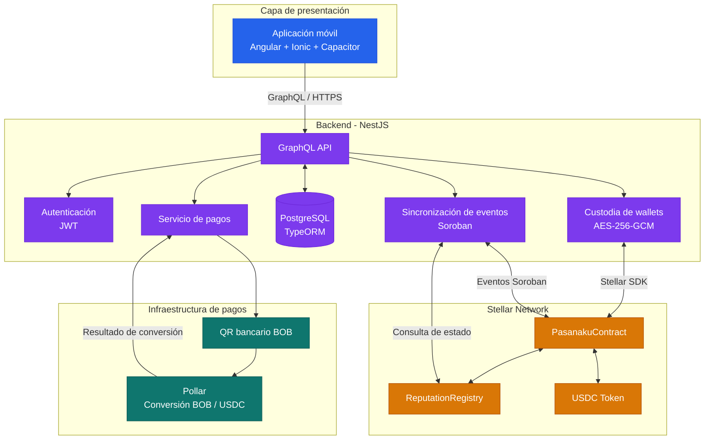
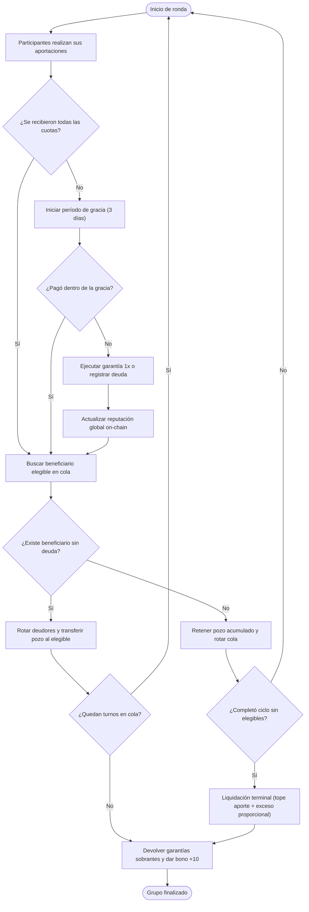
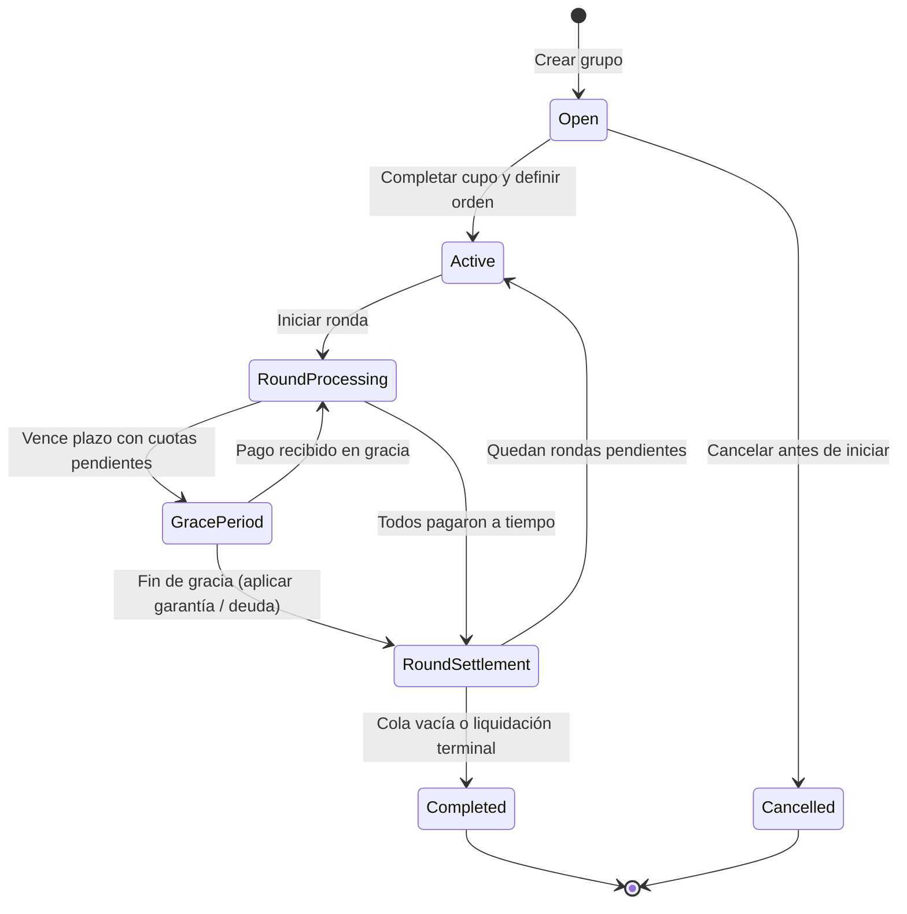
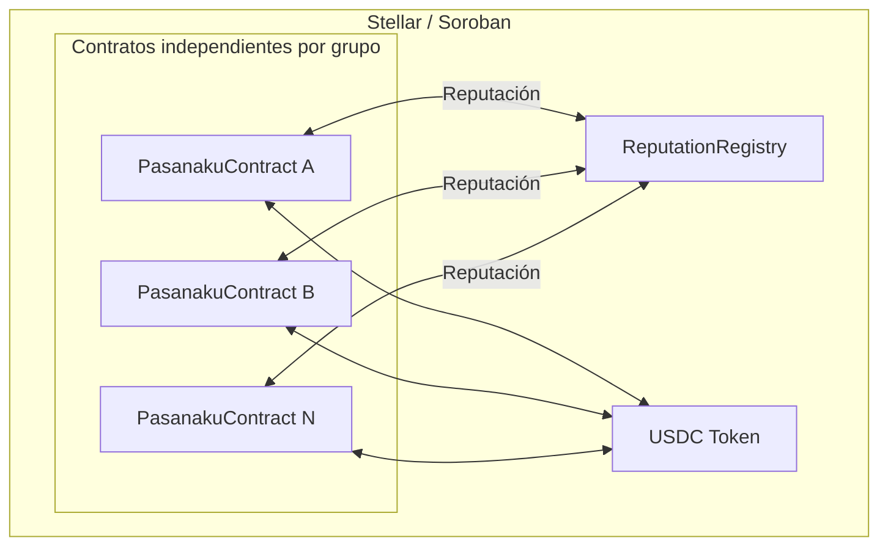

# Pasanaku On-Chain

### Ahorro colectivo comunitario sobre Stellar y Soroban.

[](https://stellar.org)
[](https://www.rust-lang.org)
[](https://nestjs.com)
[](https://graphql.org)
[](https://www.postgresql.org)
[](https://ionicframework.com)
[](https://angular.dev)

Plataforma móvil de ahorro colectivo rotativo (**Pasanaku**) digitalizado sobre la blockchain de **Stellar**, diseñada para fomentar la inclusión financiera, la transparencia y la confianza comunitaria en Bolivia mediante contratos inteligentes en **Soroban**, pagos en **USDC** y un sistema de **reputación global on-chain**.

---

## Tabla de contenidos

- [El problema y nuestra solución](#el-problema-y-nuestra-solución)
- [Arquitectura del sistema](#arquitectura-del-sistema)
- [Flujo de funcionamiento](#flujo-de-funcionamiento)
- [Ciclo de vida de un grupo](#ciclo-de-vida-de-un-grupo)
- [Estructura del monorepo](#estructura-del-monorepo)
- [Reglas principales del protocolo](#reglas-principales-del-protocolo)
- [Requisitos previos](#requisitos-previos)
- [Instalación y ejecución local](#instalación-y-ejecución-local)
- [Estado del MVP: qué es real y qué está simulado](#estado-del-mvp-qué-es-real-y-qué-está-simulado)
- [Despliegue en testnet](#despliegue-en-testnet)
- [Cuenta demo](#cuenta-demo)
- [Modelo de custodia y camino a la no custodia](#modelo-de-custodia-y-camino-a-la-no-custodia)
- [Modelo de negocio](#modelo-de-negocio)
- [Validación con usuarios](#validación-con-usuarios)
- [Equipo y licencia](#equipo-y-licencia)
- [Seguridad y privacidad](#seguridad-y-privacidad)

---

## El problema y nuestra solución

El **Pasanaku** es una de las prácticas de ahorro comunitario más arraigadas en Bolivia, pero en su formato tradicional sufre de falta de transparencia, manejo manual en efectivo y riesgo de impago temprano (_early default_).

**Pasanaku On-Chain** digitaliza y protege este modelo sin perder su esencia social:

- **Transparencia y custodia automática:** Los fondos se gestionan mediante contratos inteligentes en Stellar Soroban, eliminando intermediarios humanos que retengan el dinero.
- **Experiencia local sin fricción:** Los usuarios se registran con su número de celular y no necesitan configurar wallets externas. Los grupos operan en **USDC**. El aporte desde bolivianos (**BOB**) vía QR bancario y **Pollar** está diseñado y funciona en **modo simulación** en esta versión (ver [Estado del MVP](#estado-del-mvp-qué-es-real-y-qué-está-simulado)).
- **Confianza verificable:** Combina un sistema de **reputación global on-chain**, garantías 1x, verificación de identidad (**KYC**) y una **red de contactos de referencia** (familiares/amigos registrados) para respaldar el cumplimiento.

---

## Arquitectura del sistema

La solución utiliza una arquitectura híbrida que conecta una aplicación móvil, un backend custodial, servicios de pago y contratos inteligentes desplegados en Stellar.



### Componentes principales

| Componente      | Tecnología                  | Responsabilidad                 |
| --------------- | --------------------------- | ------------------------------- |
| Frontend        | Angular + Ionic + Capacitor | Interfaz móvil                  |
| Backend         | NestJS + GraphQL            | Lógica de negocio y API         |
| Base de datos   | PostgreSQL + TypeORM        | Persistencia                    |
| Smart Contracts | Rust + Soroban              | Reglas financieras              |
| Blockchain      | Stellar                     | Registro y liquidación on-chain |
| Pagos           | Pollar                      | Integración BOB / USDC          |

---

## Flujo de funcionamiento

El funcionamiento de Pasanaku On-Chain sigue un proceso de aportaciones periódicas, evaluación de participantes y distribución del fondo común.



---

## Ciclo de vida de un grupo

El siguiente diagrama representa los principales estados del ciclo de vida de un grupo Pasanaku.



---

## Estructura del monorepo

El proyecto está organizado en tres componentes principales:

- **`contracts/`**: Smart Contracts desarrollados en Rust (`soroban-sdk = 29.0.1`).
  - `pasanaku/`: Gestión de grupos (2 a 20 miembros), garantías 1x, rondas, período de gracia (3 días por defecto), deudas directas, reasignación de turnos y liquidaciones terminales.
  - `reputation_registry/`: Registro global y permanente de reputación financiera compartida entre grupos.

- **`backend-pasanaku-app/`**: API GraphQL (Code-First) construida con **NestJS**, **PostgreSQL** y **TypeORM**. Gestiona registro/login por celular con JWT, custodia cifrada de wallets Stellar (AES-256-GCM), verificación KYC, contactos de referencia, rampa fiat con Pollar, tareas programadas y sincronización idempotente de eventos Soroban.

- **`frontend-pasanaku-app/`**: Aplicación móvil híbrida desarrollada con **Angular + Ionic + Capacitor**.

### Arquitectura de contratos inteligentes

Cada grupo dispone de su propio contrato Pasanaku, mientras que todos comparten un registro global de reputación.



---

## Reglas principales del protocolo

### 1. Garantía 1x

Cada participante deposita una garantía equivalente a 1 cuota al unirse. Cubre un único incumplimiento tras el período de gracia (no se repone) y se devuelve al finalizar si no fue utilizada. Es un **depósito reembolsable, no un costo**: el efecto para el usuario es de liquidez (1 cuota inmovilizada durante el ciclo), a cambio de que el grupo esté protegido contra el impago.

### 2. Período de gracia

3 días posteriores al vencimiento de cada ronda (configurable para demostraciones en Testnet) antes de ejecutar garantías o registrar incumplimientos.

### 3. Reputación global on-chain

- Puntaje base inicial: **`100` puntos**.
- Puntaje máximo: **`200` puntos**.
- Primer incumplimiento (tras gracia): **`-10` puntos**.
- Segundo incumplimiento: **`-30` puntos** adicionales.
- Completar un grupo sin faltas ni uso de garantía: **`+10` puntos**.
- Restricción: usuarios con puntaje **`≤ 40`** no pueden crear ni unirse a grupos públicos, aunque sí pueden participar en grupos privados bajo aprobación del organizador. El umbral para ocupar el primer **30 %** de los turnos se define en el contrato.
- La reputación es **pública**: cualquier usuario puede ver el puntaje, los grupos completados y los incumplimientos de los demás antes de unirse o invitar.

### 4. Continuidad sin congelamiento

Si el beneficiario de turno tiene deuda, su cobro se reasigna al final de la cola y cobra el siguiente participante al día. Si ningún miembro es elegible en una ronda, el pozo se retiene hasta encontrar un beneficiario o ejecutar la liquidación final con reparto proporcional de excedentes.

### 5. Recuperación directa y respaldo social

Los pagos atrasados se transfieren directamente a la wallet del beneficiario que recibió el pozo incompleto, aplicando exenciones recíprocas en el turno final. Ante impagos sin garantía, el administrador del grupo puede consultar los contactos de referencia aceptados del deudor.

---

## Estado del MVP: qué es real y qué está simulado

| Componente                                          | Estado                               | Detalle                                                                                                                                                                             |
| --------------------------------------------------- | ------------------------------------ | ----------------------------------------------------------------------------------------------------------------------------------------------------------------------------------- |
| Contratos `PasanakuContract` y `ReputationRegistry` | **Real, en Stellar Testnet**         | Garantía, rondas, gracia, deudas, liquidación y reputación se ejecutan on-chain.                                                                                                    |
| Aportes, desembolso del pozo y reputación           | **Real en Testnet**                  | Cada operación genera una transacción verificable (ver [Despliegue](#despliegue-en-testnet)). El USDC de Testnet no tiene valor real.                                               |
| Liquidación automática de rondas                    | **Real**                             | Tarea programada del backend que invoca `settle_round`.                                                                                                                             |
| Pago en BOB con QR (Pollar)                         | **Simulado**                         | `POLLAR_MOCK_MODE=true`: el QR es de prueba y el pago se confirma con un botón de simulación. Pollar documenta un corredor BOB ↔ USDC (QR bancario); **no está integrado todavía**. |
| Verificación KYC                                    | **Simulada** (aprobación automática) | `KYC_AUTO_APPROVE=true` para la demo.                                                                                                                                               |
| Fondeo de USDC                                      | **Testnet**                          | USDC emitido por la cuenta administradora del proyecto.                                                                                                                             |

## Despliegue en testnet

Red: **Stellar Testnet**. Explorador: [stellar.expert](https://stellar.expert/explorer/testnet).

| Contrato                        | ID                                              | Enlace                                                    |
| ------------------------------- | ----------------------------------------------- | --------------------------------------------------------- |
| `ReputationRegistry`            | `CA6S45KIHYGAUOTPRYRT4FLFHFDGLBKXWVI5NHJAPXTXPEDJUSHKF2R4`         | `https://stellar.expert/explorer/testnet/contract/CA6S45KIHYGAUOTPRYRT4FLFHFDGLBKXWVI5NHJAPXTXPEDJUSHKF2R4` |
| `PasanakuContract` (grupo demo) | `CABEIRAD25L3XAXFTLFPXQ3KZLD2JFW2WLH6AV7Q7CDQQWL4XPIXDMY5` | `https://stellar.expert/explorer/testnet/contract/CABEIRAD25L3XAXFTLFPXQ3KZLD2JFW2WLH6AV7Q7CDQQWL4XPIXDMY5` |
| USDC (SAC de testnet)           | `CBP62ZCY337CMOP4K5DSJBJTZ66JTIIO6FJLW4QL6PHERLB6W4LOHDET`               | `https://stellar.expert/explorer/testnet/contract/CBP62ZCY337CMOP4K5DSJBJTZ66JTIIO6FJLW4QL6PHERLB6W4LOHDET` |                                                        |

## Cuenta demo

Para probar sin registrarse:

- Usuario (celular): `76543210`
- Contraseña: `76543210`
- Contiene un grupo ya iniciado con rondas cortas de demostración. Los pagos en BOB se confirman con el botón de simulación.

## Modelo de custodia y camino a la no custodia

Distinguimos dos cosas:

- **El dinero del grupo (cuotas, garantías y pozo)** está en el contrato Soroban de cada grupo. Solo las reglas del contrato lo mueven..
- **Las llaves de las wallets de los usuarios** las custodia hoy el backend (cifradas con AES-256-GCM) para que personas sin experiencia cripto puedan usar la app solo con su celular. **Es una decisión de MVP**: quien controle el backend podría firmar en nombre de un usuario, por lo que no afirmamos que «nadie custodia el dinero».

Mitigaciones actuales: cifrado en reposo, nunca se expone la llave por la API, rate limiting, KYC y operaciones de organizador limitadas por el contrato.

**Camino a la no custodia:** migrar a wallets con passkeys o smart wallets co-firmadas (p. ej. las wallets co-firmadas / self-custody que ofrece Pollar), de modo que el usuario autorice cada firma desde su dispositivo.

## Modelo de negocio

> Propuesta a validar; **la comisión no está implementada en esta versión**.

Ejemplo: grupo de 6 miembros × 20 USDC por ronda × 6 rondas = 720 USDC de flujo. Una comisión del 1 % equivale a **7,20 USDC por ciclo** (1,20 USDC por grupo al mes).

Grupos activos necesarios = costos fijos mensuales ÷ 1,20 USDC. Por ejemplo, con 100 USDC/mes de costos fijos (on/off-ramp, KYC, infraestructura) harían falta unos 84 grupos activos. Los costos reales están `<<por medir>>`; las comisiones de red de Stellar son mínimas, el costo dominante esperado es la rampa fiat y el KYC.

Por qué un miembro aceptaría recibir el 99 %: protección contra el impago (garantía 1x y reputación pública), ahorro denominado en USDC y transparencia verificable. **Es una hipótesis**: es la pregunta 4 de la validación.

## Validación con usuarios

Entrevistas cortas a organizadores y participantes de pasanakus. Solo se reportan respuestas reales.

Preguntas: (1) ¿cuántos miembros tiene tu grupo? (2) ¿de cuánto es la cuota y cada cuánto se paga? (3) ¿cuántos impagos sufriste en el último año? (4) ¿aceptarías una garantía de 1 cuota y 1 % de comisión a cambio de protección contra impagos?

- Fecha: `22/11/2026` · Ciudad: `Oruro` · Muestra: **n = `5`** · Método: `WhatsApp`

| #   | Tamaño del grupo | Cuota  | Impagos (último año) | ¿Acepta garantía 1x + 1 %? |
| --- | ---------------- | ------ | -------------------- | -------------------------- |
| 1   | `5`           | `1000 Bs cada mes` | `1`               | `Si`                     |
| 2   | `6`           | `500 Bs cada mes` | `2`               | `Si`                     |
| 3   | `7`           | `350 Bs cada mes` | `1`               | `Si`                     |
| 4   | `3`           | `1200 Bs cada mes` | `0`               | `No sabría responder`                     |
| 5   | `5`           | `600 Bs cada mes` | `0`               | `Si`                     |

Limitaciones: muestra pequeña y de conveniencia; no es un estudio estadístico.

## Equipo y licencia

- `Rafael Argote Zeballos` — `frontend y contracts` — `https://www.linkedin.com/in/rafael-argote-zeballos-2423b2443/`
- `Luis Alejo Andrade` — `backend y contracts` — `https://www.linkedin.com/in/luis-alejo/`

Los contratos de `contracts/` se publican bajo licencia **MIT** (ver `contracts/LICENSE`).

## Requisitos previos

- **Node.js** `>= 20` y **npm**
- **PostgreSQL** `>= 15`
- **Rust** y **Cargo** con target `wasm32v1-none`
- **Stellar CLI** (`stellar --version`)

---

## Instalación y ejecución local

### 1. Smart Contracts (Soroban)

```bash
cd contracts
cargo test --workspace
cd reputation_registry && stellar contract build
cd ../pasanaku && stellar contract build
```

### 2. Backend (NestJS + PostgreSQL)

```bash
cd backend-pasanaku-app
cp .env.example .env

# Configurar DATABASE_URL, ENCRYPTION_KEY, JWT_SECRET
# y credenciales de Stellar Testnet.

npm install
npm run migration:run
npm run start:dev
```

El playground de **GraphQL** estará disponible en:

`http://localhost:3000/graphql`

### 3. Frontend (Ionic + Angular)

```bash
cd frontend-pasanaku-app
npm install
ionic serve
```

---

## Seguridad y privacidad

- **Privacidad on-chain:** Ningún dato personal (nombres, números de teléfono, carnets de identidad o contactos de referencia) se almacena en la blockchain.
- **Custodia cifrada:** Las llaves privadas de Stellar y los documentos de identidad se cifran con **AES-256-GCM** y se indexan mediante hashes HMAC en PostgreSQL sin exponerse jamás en la API GraphQL. Esto es **custodia por parte del backend**: ver [Modelo de custodia](#modelo-de-custodia-y-camino-a-la-no-custodia) para sus límites y el plan para eliminarla.
- **Protección contra fuerza bruta:** límite de peticiones en `login` y `register` (`@nestjs/throttler`).
